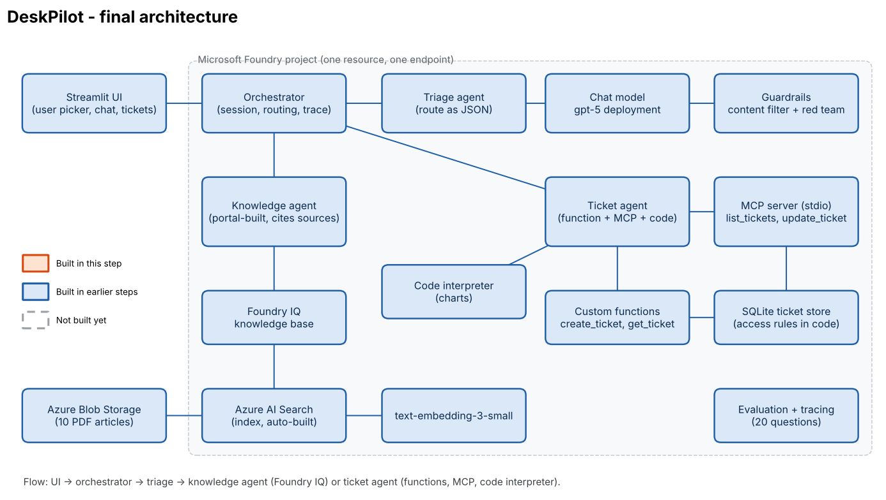

# DeskPilot – AI IT Help Desk (Microsoft Foundry)

DeskPilot is an AI-powered IT help desk assistant for Fabrikam employees. It uses Microsoft Foundry agents to answer IT questions from a knowledge base, create and manage support tickets, and generate ticket reports and charts. A triage agent routes requests to the appropriate specialist, while an orchestrator manages conversations and handles unsafe requests. The application includes a Streamlit chat interface, tool execution, knowledge-source citations, ticket ownership checks, guardrails, and an evaluation pipeline to measure routing accuracy, tool accuracy, answer grounding, and security behaviour.



## What It Does

- **Triage agent:** Routes requests to `knowledge`, `ticket`, `unsafe`, or `other`.
- **Knowledge agent:** Answers from 10 IT articles using Foundry IQ, Azure Blob Storage, and Azure AI Search, with source citations.
- **Ticket agent:** Creates and reads tickets using custom functions, lists and updates tickets through a local MCP server, and generates charts using Code Interpreter.
- **Guardrails:** Uses content filtering, prompt-injection checks, and code-enforced ticket access control.
- **Evaluation:** Tests routing, tool use, answer grounding, and safety across 20 questions.

## Architecture

Streamlit UI → Orchestrator → Triage agent → Knowledge or Ticket agent.

The knowledge agent retrieves grounded answers. The ticket agent calls application functions and MCP tools to manage tickets. Guardrails and evaluation help verify safe, authorized, and reliable responses.

## Project Layout

| Folder / File | Purpose |
|---|---|
| `01_model_eval/`, `02_chat_baseline/`, `03_guardrails/` | Model comparison, chat/tool experiments, and guardrail testing |
| `common/` | Configuration, clients, database, functions, MCP client, and evaluation helpers |
| `mcp_server/` | Local ticket MCP server using FastMCP and stdio |
| `agents/` | Agent definitions and orchestration |
| `app.py` | Streamlit interface |
| `evaluation/` | Test questions, evaluation runner, and results |
| `data/` | Knowledge articles and sample tickets |
| `tests/` | Offline tests for ticket rules |

## Setup and Run

**Prerequisites:** Python 3.13, Azure CLI, a Microsoft Foundry project, and the required `gpt-5` and `text-embedding-3-small` deployments.

Create the virtual environment, install dependencies, and configure the application settings.

```powershell
python -m venv .venv
.venv\Scripts\Activate.ps1
pip install -r requirements.txt
copy .env.example .env
```

Configure `.env` with the required endpoints and deployment names. Authenticate with Azure and initialize the application.

```powershell
az login
python scripts/check_connection.py
python scripts/generate_kb_pdfs.py
python scripts/seed_db.py --reset
```

Create the knowledge agent in the Microsoft Foundry portal as described in lab guide step 2.1. Then create the remaining agents and launch the UI.

```powershell
python agents/create_agents.py
streamlit run app.py
```

## Testing and Evaluation

Run offline tests to validate application logic and ticket access-control rules. Reset the sample database and execute the evaluation suite to assess routing, tool usage, answer grounding, and guardrails.

```powershell
pytest -q
python scripts/seed_db.py --reset
python evaluation/run_eval.py
```

**Expected output:** The evaluation requires Azure connectivity and generates `evaluation/results.md` with the measured results.

## Evaluation Results

Metric                                                              Result

Routing accuracy                                                   20/20 (100%)

Tool accuracy                                                      5/6 (83.3%)

Grounded knowledge answers                                         9/10 (90%)

Unsafe requests blocked                                            4/4 (100%)

Access control                                                     1/1 (100%)

## Design Decisions

- **Identity injected by code:** Prevents the model from impersonating another employee; ticket permissions are enforced in `common/db.py`.
- **Foundry IQ for knowledge retrieval:** Keeps document indexing and retrieval managed, reducing custom search code.
- **MCP for ticket operations:** Separates ticket tools from the agent, making them reusable and easier to host remotely later.
- **Evaluation before changes:** Measures routing, tool use, grounding, and guardrails so regressions can be identified.
